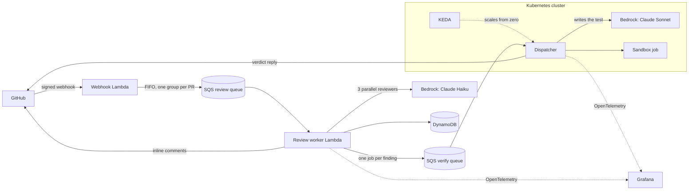

# uxie

uxie is a GitHub App that reviews pull requests. It reads the diff, leaves inline comments
on bugs and risky changes, and summarizes the PR. For many of the bugs it reports, it also
writes a test and runs it in a sandbox against the code before and after the PR, so its
comments come with proof instead of only an opinion.

## Reviewing

When you open or update a pull request, three reviewers read the diff in parallel, each
looking for one kind of problem:

- **logic**: wrong conditions, operators, arithmetic, off-by-one errors
- **edge cases**: empty or missing values, boundaries, unhandled errors
- **contracts**: changes that break callers, violate invariants, or do things in the
  wrong order

uxie posts a review with a short summary and inline comments on the exact lines, usually
within 10 to 20 seconds. This works for any language. When you push new commits, it reviews
again and does not repeat comments it already made. You can also ask for a fresh review by
commenting `/review`.

## Verifying

For bugs that can be shown in a unit test, uxie goes a step further. It writes a test that
checks what the code should do and runs it twice in a sandbox: on the code before the PR
and on the code after. The result is posted as a reply under the comment, usually within a
minute or two:

| Before the PR | After the PR | Reply |
|---|---|---|
| passes | fails | Confirmed: the PR introduced this bug. The test is attached. |
| can't run (new code) | fails | Reproduced |
| not run | passes, and the flagged line ran | Couldn't reproduce |
| anything else | | no reply |

Verification also keeps reviews quiet. Findings uxie is confident about are always posted.
Less certain ones, in languages it can test, are posted only if a test backs them up. That
lets it look hard for bugs without filling the PR with false alarms.

## Languages

| Language | Reviewed | Verified with tests |
|---|---|---|
| Python | yes | pytest, Hypothesis for property-based tests |
| Go | yes | `go test`, `testing/quick` |
| TypeScript and JavaScript | yes | Node's built-in test runner, fast-check |
| React components | yes | Testing Library with a simulated DOM |
| Anything else | yes | reviewed normally; findings aren't tested yet |

Tests may replace a project's external dependencies (clock, storage, network clients) with
fakes, but never the code under test.

## Architecture



Reviews run on AWS Lambda because they are short and bursty. Tests run on Kubernetes because
running untrusted code needs a fresh, locked-down container for every run, which Lambda does
not provide. The cluster is k3s on a small always-on cloud server (an Oracle Cloud Always
Free ARM VM). It pulls jobs from SQS, so it needs no inbound network access beyond SSH, and
KEDA scales the worker to zero when the queue is empty.

## The sandbox

Every test run is a single-use Kubernetes Job with:

- no network access, including DNS
- a read-only filesystem and a read-only copy of the code
- a non-root user, no Linux capabilities, and no Kubernetes API token
- limits on CPU, memory, processes, and time
- the namespace set to the "restricted" Pod Security standard

Kubernetes applies a network policy a moment after a pod starts, so for about a second a new
pod can still reach the internet. The sandbox checks for that itself and does not run any
test code until outbound traffic is blocked; if it never is, the run is refused.

Dependencies are installed in a separate step, and that step never runs package code:
Python installs prebuilt wheels only, Go only downloads modules, and npm runs with
`--ignore-scripts`. A `setup.py` is parsed, never executed.

Each run also records which lines of the flagged file actually executed. A test that never
reaches the suspect line cannot confirm or refute anything, so the test writer is asked to
try again.

## Reliability

- GitHub webhooks are verified with HMAC signatures.
- Duplicate deliveries are dropped by the FIFO queue and by conditional writes in DynamoDB.
  A finished review or verdict is never repeated.
- While a test runs, a heartbeat keeps the job claimed. If the worker dies, another one picks
  the job up within about two minutes.
- Jobs that keep failing go to a dead-letter queue, which triggers an email alert.
- `ops/chaos.py` checks this against the live system: it kills a worker mid-run and checks
  that exactly one verdict is posted.

## Observability

Each pull request produces one trace, from the webhook through the review, the queue, and the
sandbox runs, across AWS and the cluster. Metrics cover reviews, findings, verdicts, latency,
token use, and cost. The Grafana dashboard is generated from code in `deploy/grafana/`.

## How well it works

uxie is measured on real commits with injected bugs and on real bugs found in project
history. Results and methods are in [bench/results/summary.md](bench/results/summary.md).

## Running it

You need an AWS account with Bedrock access, a GitHub App, Docker, and Helm, plus either an
Ubuntu server you can SSH into or k3d for a local cluster.

```sh
make install
make deploy                         # AWS stack; copy infrastructure/parameters.example.json first
./deploy/remote.sh ubuntu@HOST      # verification cluster on a server
# or, on your own machine:
./deploy/k3d.sh && make dispatcher  # local cluster
make check                          # lint, types, tests
```

## Repository layout

```
src/uxie/         review, verification, sandbox, and GitHub code
src/lambdas/      Lambda entry points
sandbox/          sandbox images and the test runner
dispatcher/       verification worker image
deploy/           cluster script, Helm chart, Grafana dashboard
infrastructure/   SAM template
bench/            benchmark tooling
ops/              chaos tests
tests/            unit and integration tests
```

## Limits

- Verification covers Python, Go, TypeScript, and JavaScript. Other languages are reviewed
  but not verified.
- Some bugs can't be shown in a unit test: race conditions, performance problems, visual UI
  issues, and code that needs a network or a real database. Those stay as review comments.
- Verification runs on a single small server. If it is down, jobs wait in the queue for up
  to four days. Confident findings are still posted; held findings are not.
